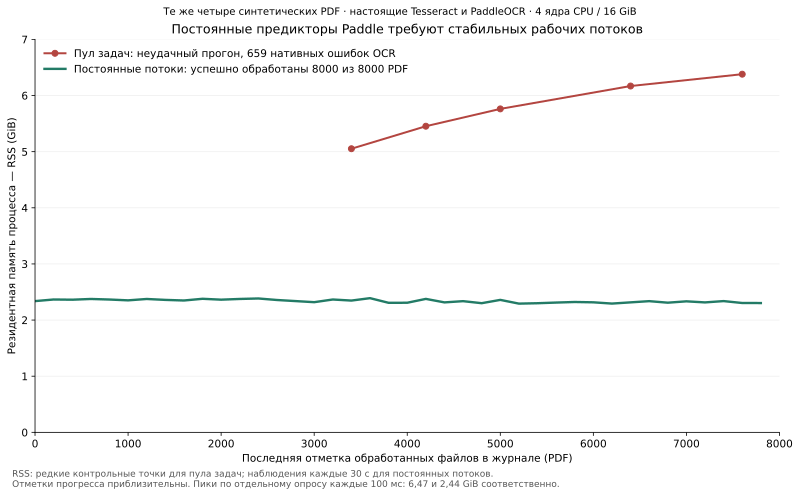

# Скорость распознавания и большая таблица

## Штатный ускоренный режим 1.3

**Полный Windows-прогон: 8000 PDF за 22 минуты 29,68 секунды**, 5,93 PDF/с.
Все 8000 имен и SHA-256 совпали; ошибок, пропусков и неверных имен нет.
Стенд: AMD EPYC 7763, 4 vCPU, около 16 ГиБ, Windows Server 2022, Tesseract 5.5.0.
Выбраны ONNX Runtime с теми же FP32-моделями, строгая сверка с Tesseract, чтение одиночных
полей без детектора при подтверждении обоими способами и восемь постоянных обработчиков.
Пик RSS по опросу 100 мс — **1,73 ГиБ**; CPU-время 4828,36 с, средняя загрузка 3,58 процессора.
Первый результат появился через 6,14 с. **Цель 20 минут на этом Windows-стенде еще не достигнута.**
[Полный JSON](integrated-windows/windows-onnx-known-lines-8000.json).

Перед полным замером три варианта последовательно проверены на той же машине:

| Режим, по 1000 PDF | Обработчики | Время, с |
|---|---:|---:|
| Native Paddle, известные строки | 4 |199,986|
| ONNX, известные строки | 4 |183,173|
| ONNX, известные строки | 8 |**175,310**|

Все 3000 имен и хешей правильны. Восемь обработчиков с ONNX дали на 12,3% меньшее время,
чем native с четырьмя, и на 4,3% меньшее, чем ONNX с четырьмя.
Это контролируемое сравнение новых вариантов; прежние22–46-минутные прогнозы и старый
30:30 Windows-замер на другом стенде не являются той же машиной.
[Все отчеты](integrated-windows/), [совпадение SHA-256 моделей с поставкой](integrated-windows/models-match.json).

Набор полного замера — 8000 копий четырех заранее описанных одностраничных синтетических
PDF и три сохраненных шаблона. Каждый файл действительно проходит PDF-рендер, подбор
шаблона, оба OCR и переименование; кеша ответов нет. Время включает модели, шаблоны,
перечисление и переименование, исключая создание тестовых копий, отдельный прогрев
и финальное сравнение хешей. Производственные 8000 разных документов могут дать другую скорость.

## Предыдущий native-режим 1.2 и исходные сравнения

Контрольные замеры Linux сделаны 17.11.2026 на одной машине: AMD EPYC 9V74, лимит **4 процессора
и 16 ГиБ** в контейнере, Ubuntu 24.04.5, .NET 10.0.15, Tesseract 5.3.4. Варианты запускались
последовательно, без параллельных сборок и тестов. Полный Windows-прогон выполнен отдельно на
GitHub Actions `windows-2022`, также 4 логических процессора и около 16 ГиБ, Tesseract 5.5.0.
Модель процессора в том Windows-отчете не записана; одинаковое число vCPU не означает одинаковую
производительность. Версия программы — 1.2.0.

## Подтвержденный полный прогон 8000 PDF

**На Linux 8000 из 8000 PDF обработаны за 19 минут 9,82 секунды**: 6,96 PDF/с, восемь постоянных
обработчиков в режиме «Авто». Все 8000 имен совпали с заранее заданными, SHA-256 всех PDF
сохранены. Ошибок, пропусков и неправильных имен — ноль. Пик RSS по опросу каждые 100 мс —
**2,44 ГиБ**. Расход памяти в наблюдениях на протяжении партии оставался около 2,3–2,4 ГиБ.

[Полный JSON](shipping-default-auto-dedicated-8000.json) и
[наблюдения памяти](shipping-default-auto-dedicated-8000-memory-checkpoints.jsonl).
Это фактическое время всей партии, включая загрузку шаблонов, создание моделей и
переименование. Подготовка копий, отдельный прогрев и финальная проверка хешей — вне таймера.
Время появления первого результата — 5,50 с. Библиотеки и диспетчеризация взяты из обычных
настроек ядра, без параметров для искусственного ускорения измерения.

Цель до 20 минут достигнута на описанном стенде и наборе. **Набор содержит копии четырех
разных одностраничных синтетических PDF и три шаблона**, каждый файл действительно читают
Tesseract и PaddleOCR. Это не проверка 8000 разных производственных документов; число страниц,
качество сканов, похожие шаблоны, диск и ПК влияют на время.

Полный Windows-прогон тоже прошел проверку всех 8000 имен и хешей без ошибок и пропусков,
но занял **30 минут 30,17 секунды**, 4,37 PDF/с, пик RSS 2,58 ГиБ
([JSON](windows-default-auto-dedicated-8000.json)). **На этом Windows-стенде цель 20 минут
этим вариантом не достигнута.** Это измеренное время OCR, а не общая длительность задания:
прогрев закончился в 23:11:06 UTC, последняя отметка OCR — 23:41:36 UTC.

| Показатель | Linux | Windows |
|---|---:|---:|
| Файлов, имен и хешей проверено | 8000 | 8000 |
| Фактическое время | 19:09,82 | 30:30,17 |
| Ошибки / пропуски / неверные имена | 0 / 0 / 0 | 0 / 0 / 0 |
| Пик RSS | 2,44 ГиБ | 2,58 ГиБ |
| CPU-время всего | 4267,87 с | 7066,61 с |
| Среднее использование процессоров | 3,71 | 3,86 |

Windows-прогон потребовал в 1,66 раза больше CPU-времени на документ. Очередь не объясняет
такую разницу: процессоры заняты почти полностью. Это основание сравнить стоимость этапов и
варианты вычислений на одном Windows-стенде; переносить Linux 19:10 на произвольный Windows-ПК
нельзя. Подробное сравнение записано ниже и воспроизводится сценарием `performance-options`.

## Проверка вариантов на Windows

Восемь вариантов запускались последовательно **на одной машине AMD EPYC 7763, 4 vCPU**.
Это отдельный Windows-стенд; модель CPU прежнего полного Windows-прогона неизвестна.
Каждый вариант правильно переименовал все 100 PDF и сохранил их хеши.

| oneDNN | Пакет полей | Обработчики | 100 PDF, с |
|---|---|---:|---:|
| да | да | 4 | 32,867 |
| да | да | 8 | 34,228 |
| да | нет | 4 | 39,718 |
| да | нет | 8 | 38,354 |
| нет | да | 4 | **31,695** |
| нет | да | 8 | 33,261 |
| нет | нет | 4 | 39,280 |
| нет | нет | 8 | 38,753 |

Выигрыш отключения oneDNN в лучшей короткой паре — около 3,6%. Время создания моделей на
восьми обработчиках больше, поэтому короткая партия не определяет лучший параллелизм для 8000.
Победитель короткого теста прошел еще **1000 PDF за 287,82 с**, все имена и хеши правильны.
Его расчетные 38,38 минуты для 8000 — экстраполяция, а не полный замер. На основании этой
разницы производственные настройки не переключались.

Профиль обычного пакетного варианта объяснил основную разницу со стендом Linux: PaddleOCR
346 против 199 мс/документ, а подбор шаблона 113 против 104 мс, рендер PDF 85 против 87 мс.
Измеренные стоимость этапов и модель CPU не доказывают единственную причину различия между
двумя ОС: отличаются сами машины и нативные сборки. [Все отчеты](windows-options/),
[разбор](windows-options/analysis.json).

Отдельно проверен точный Hamming на Windows EPYC 7763: 20 чередующихся ABBA-измерений на
12 парах реальных дескрипторов. Текущий управляемый поиск занял в среднем **538 мс**, а
нативный BFMatcher при одном потоке — **5737 мс**, в 10,66 раза дольше. Оба индекса и оба
расстояния совпали для 59 798 проверенных строк, включая равенства, ROI и один train-дескриптор.
Это время компонента с уже подготовленными дескрипторами, не время чтения PDF.
JIT использует четыре аппаратных POPCNT; гипотеза о ложной зависимости назначения
не подтвердилась. Изменение этого алгоритма не обосновано результатом теста.
[JSON](matching-windows/matching.json), [машинный код](matching-windows/matching-jit.txt),
[измеритель](../../tools/MatchingPerformance/README.md).

SHA-256 самих PDF в этих проверках совпадают. У всех трех JSON-разметок Windows-хеши
точно совпадают с хешами Linux-файлов после замены LF на CRLF; содержимое JSON одинаково.
Различие хешей дескрипторов между платформами — отдельный факт, его причина этим тестом
не установлена. Все сравнения двух методов внутри Windows выполнялись на одних и тех же
подготовленных матрицах.

## Контрольное сравнение новых вариантов на Windows

18.11.2026 три варианта последовательно обработали по **1000 PDF на одной и той же
виртуальной машине**: Intel Xeon Platinum 8573C, 4 логических процессора, около 16 ГиБ,
Windows Server 2022, .NET 10.0.15, Tesseract 5.5.0. Ядро, модели, набор и настройки совпадают,
кроме режима известных строк (`known-lines`) и явно указанного числа обработчиков.
Набор — копии четырех синтетических документов; все файлы читают оба OCR.

| Вариант | Обработчики | 1000 PDF, с | Отчет |
|---|---:|---:|---|
| Обычный поиск строк PaddleOCR (`known-lines=false`) | 8 | 345,731 | [JSON](known-lines-windows/known-false-workers-8.json) |
| Известные строки (`known-lines=true`) | 4 | 224,542 | [JSON](known-lines-windows/known-true-workers-4.json) |
| Известные строки (`known-lines=true`) | 8 | **222,614** | [JSON](known-lines-windows/known-true-workers-8.json) |

В каждом варианте совпали **1000 из 1000 имен и SHA-256**, ошибок и пропусков нет. При восьми
обработчиках время сократилось на **35,6%**, ускорение — **1,55 раза**. Расчетные **29,7 минуты
для 8000 PDF — экстраполяция по партии 1000**, не фактический полный прогон. Это сравнение
внутри одного стенда; его времена нельзя напрямую сопоставлять с прежними Windows-замерами
на другом CPU. [Все JSON этого сравнения](known-lines-windows/).

Отдельный эксперимент с ONNX Runtime выполнен на Windows с AMD EPYC 7763 и 4 vCPU:
11 вырезок полей, сгруппированных в пять документов, по десять повторов отдельно и пакетами.
Во всех **220 сравнениях** совпали текст и координаты, а в пакетах — также результаты разбора;
максимальная разница уверенности — 0,00000591 при допуске 0,00001. Нечеткий образец сохранен:
совпадение двух вариантов само по себе не означает правильный текст.

Пакетный этап PaddleOCR занял 1083,98 вместо 1711,59 мс — **ускорение 1,58 раза только этой
части OCR**. Рендер PDF, подбор шаблона, Tesseract, сверка и переименование в этот таймер
не входят; это не ускорение приложения целиком.
[Исходный JSON](onnx-windows/onnx-comparison-windows.json).

Интегрированный вариант затем прошел полный Windows-замер 8000 файлов за 22:29,68;
результат и границы набора приведены в начале документа. Цель 20 минут не достигнута.

## Что изменилось

Для штатного режима 1.3 отдельно проверены готовые локальные ONNX-модели и чтение одиночных
строк: **325 тестов ядра и 24 теста окна прошли**. Все пять исходных PDF дали точные имена
([JSON](selected-defaults-5.json)), включая `АЦИЕ.202132.004 Э(Т)О МОЭА Спецификация.pdf`.
PDF и координаты разметки не заменялись.

После ужесточения проверки мелких вторых строк набор из 48 разных PDF дал **44 точных имени,
4 отказа, 0 неверных имен** ([JSON](selected-defaults-48.json)). Все 44 ранее правильных
результата исходного native-режима сохранены. Ранний эксперимент с более свободной геометрией
давал 46 точных имен, но не покрывал мелкие строки; его результат не выдается за результат
окончательной защиты. На двух сложных 200 dpi полях «Габаритный чертеж» полный детектор
по-прежнему добавляет лишнее «й», поэтому независимая сверка отклоняет файлы.

На том же Linux-стенде штатные настройки 1.3 обработали 1000 PDF за **121,546 с**
(8,23 PDF/с, восемь обработчиков), а четыре обработчика — за **128,986 с**. В обоих
случаях все 1000 имен и хешей совпали. Восемь оказались быстрее примерно на 5,8%,
использовав 1,92 против 1,08 ГиБ пикового RSS. Расчетные 16,21 минуты для 8000 в первом
случае являются экстраполяцией; полного Linux-замера 8000 именно этой комбинации нет.
[Авто/8](linux-selected-defaults-1000.json), [4 обработчика](linux-selected-workers4-1000.json).

Дополнительные **49 проверок геометрии и сверки** прошли: буквы высотой 4–5 px во второй строке
сверху/снизу при зазоре 0/2 px требуют полного детектора; все десять исходных одиночных полей
сохранили быстрый путь. Четыре PDF с разными размерами шрифта дали восемь точных чтений в двух
режимах. [Сводка](known-line-guards-summary.json) фиксирует ограничения эвристики.

- PaddleOCR использует сборку MKL/oneDNN и сохраняет предикторы на время работы обработчика.
  Раньше библиотека клонировала их при каждом вызове. Детектор по-прежнему обрабатывает каждое
  поле отдельно; распознавание найденных строк выполняется пакетом с сохранением их полей.
- Внутренние пулы OpenCV/OpenMP ограничены: параллельно работают документы, без конкурирующих
  вложенных пулов. «Авто» выбирает до восьми обработчиков с учетом процессоров и памяти.
- При подборе шаблона сначала проверяется подходящий физический размер страницы. Если он
  не подошел, проверяются остальные размеры. Неоднозначность проверяется как прежде.
  Повторно используются маски линий и расширенная маска страницы; точное расстояние Hamming
  считается через POPCNT, с нативным запасным вариантом на остальных процессорах.
- PDFium сохраняет загруженную текущую страницу до смены страницы или закрытия PDF. Полный
  рендер и вырезки не загружают эту же страницу заново. Глобальная блокировка PDFium сохранена.

Остались оба движка, сверка их текстов, прежние модели, разрешение, число признаков и пороги
качества. Кэша результатов по содержимому PDF нет. Повторяющийся документ каждый раз проходит
совмещение, вырезание полей и оба OCR.

## Сравнение вариантов

Набор для сравнения — копии четырех положительных одностраничных PDF из
[test-samples](../test-samples/README.md): спецификация A4, сборочный чертеж A4, схема A4 и
сборочный чертеж A3, три шаблона. Каждая копия лежит в отдельной подпапке, чтобы имена не
конфликтовали. Это не набор различных производственных сканов.

| Вариант | PDF | Обработчики | Время, с | PDF/с | Исходный отчет |
|---|---:|---:|---:|---:|---|
| До изменений | 32 | 4 | 25,310 | 1,264 | [JSON](baseline-default-w4-32.json) |
| Только ограничение внутренних потоков | 32 | 4 | 24,124 | 1,326 | [JSON](baseline-limits-w4-32.json) |
| oneDNN, клонирование предикторов | 32 | 4 | 12,856 | 2,489 | [JSON](candidate-one-dnn-w4-32.json) |
| Постоянные предикторы, OpenBLAS, отдельные поля | 32 | 4 | 10,420 | 3,071 | [JSON](reuse-blas-batch-false-w4-32.json) |
| Постоянные предикторы, oneDNN, отдельные поля | 32 | 4 | 9,114 | 3,511 | [JSON](reuse-one-dnn-batch-false-w4-32.json) |
| Постоянные предикторы, oneDNN, пакет полей | 32 | 4 | **8,260** | **3,874** | [JSON](reuse-one-dnn-batch-true-w4-32.json) |
| До изменений, контроль подлиннее | 100 | 4 | 77,575 | 1,289 | [JSON](baseline-default-w4-100.json) |
| oneDNN, постоянные предикторы, пакет полей | 100 | 4 | **20,364** | **4,911** | [JSON](reuse-one-dnn-batch-true-w4-100.json) |
| Промежуточный вариант, пул задач | 100 | 4 | **20,694** | **4,832** | [JSON](shipping-dedicated-false-auto-100.json) |
| Те же настройки, выделенные потоки | 100 | 4 | 21,604 | 4,629 | [JSON](shipping-dedicated-true-auto-100.json) |
| Длинный прогон новой версии | 1000 | 4 | 166,358 | 6,011 | [JSON](shipping-default-auto-1000.json) |
| Длинный прогон новой версии | 1000 | 8 | **151,888** | **6,584** | [JSON](shipping-workers8-1000.json) |

Пакет полей с OpenBLAS оказался медленнее отдельных полей; с oneDNN — быстрее. Выбраны
**oneDNN + постоянные предикторы + пакет полей + постоянные отдельные потоки**. На партии из 1000 файлов восемь
обработчиков быстрее четырех, но используют больше памяти: пик RSS в этих прогонах 3,03 ГиБ
против 1,47 ГиБ. Поэтому «Авто» ограничивает параллелизм и по памяти.

В коротком замере на 100 файлах вариант с пулом задач ускорился в 3,81 раза, но был
отклонен после ошибки на полной партии. Выбранный вариант с постоянными потоками на 100
файлах показал 21,604 с вместо 77,575 с — **3,59 раза** при четырех обработчиках.
Длинные прогоны лучше используют прогретые
модели; их скорость нельзя выдавать за ускорение относительно не проведенного старого
длинного прогона. Во всех перечисленных замерах проверены точные имена и SHA-256 каждого
обработанного PDF, без ошибок и пропусков. Старое ядро взято из коммита
`c2587e714bee9d2f57319d2a9bb8d8a57c96c173`; добавлены только доступ измерителю и наблюдающие
таймеры, без изменения алгоритма.

## Ошибка, обнаруженная только на полной партии

Короткие прогоны до 1000 файлов не показали проблемы обычного пула задач. При попытке
обработать 8000 PDF он дал 7341 правильное переименование и 659 внутренних ошибок Paddle
(`Running predictor failed … status code 3: std::exception`), начиная с файла 003280.
Неправильных присвоенных имен нет. Время 19 минут 2 секунды — скорость попыток обработки,
**не успешное распознавание 8000 файлов**; этот вариант отклонен.
[Отчет неудачного прогона](shipping-taskpool-failed-8000-summary.json).

oneDNN хранит состояние и кеши в потоке ОС. Асинхронный обработчик пула может продолжить
работу на другом потоке. Это вероятная причина обнаруженного сбоя; одного сообщения
`std::exception` недостаточно для окончательного доказательства. В выбранном варианте
каждый обработчик работает на постоянном отдельном потоке; распознавание и освобождение
его моделей происходят на этом потоке. Создание моделей остается последовательным.
Повторный полный прогон с постоянными потоками подтвердил 8000 успешных распознаваний за
19 минут 9,82 секунды без этих сбоев. Пик памяти снизился с 6,47 до 2,44 ГиБ. Короткий замер
сам по себе не подтвердил бы это исправление.

[Данные графика](worker-memory-comparison.json). Красные контрольные точки неудачного
прогона сняты редко, зеленые успешного — каждые 30 секунд. По оси X указана последняя
завершенная отметка прогресса, а не синхронный счетчик в момент чтения RSS. Полные пики
измеритель опрашивал каждые 100 мс. [Исходные наблюдения неудачного прогона](shipping-taskpool-failed-8000-memory-checkpoints.jsonl).

Измеритель теперь сразу печатает первые ошибки и число отказов по ходу работы. В отчетах
отдельно записывается скорость успешных переименований, чтобы скорость ошибок не выглядела
как ускорение OCR. Проверки движков и пороги не изменены, повторных попыток, скрывающих
внутренний сбой, нет.

## Разные тексты, разрешения и повороты

Отдельно создано **48 различных PDF**: восемь вариантов содержимого, 200/250/300 dpi,
обычная ориентация или поворот на 90° с перекосом ±0,35°, разные обозначения, геометрия,
двухстрочные наименования, спецификации и чертежи A4/A3. Ожидаемые имена заданы до OCR;
ни один неудачный файл не исключен из проверки.

У старого и нового ядра одинаковый результат: **44 точных ответа, четыре отказа, ноль
неверных присвоенных имен**. Совпали полные записи всех 48 документов: SHA-256 вырезанных
изображений, сырой и разобранный текст обоих движков и причины отказа (120 полей, 240 ответов
движков). Уверенности в этих JSON не записаны; отдельные дифференциальные тесты предикторов
проверяют текст, геометрию и уверенность до шести знаков.

Четыре отказа — низкая уверенность обозначения A3, лишняя буква «й» в чтении «Габаритный
чертеж» на двух сканах 200 dpi и нечитаемое обозначение на одном повернутом скане 200 dpi.
Это ограничения исходного OCR, воспроизводящиеся до ускорения. Пороги для их приема не
снижались. Этот набор не выдается за 48 успешно переименованных файлов и не использован
как положительный набор для замера скорости.

Записаны [сравнение](diverse-comparison-48.json), [старое ядро](diverse-baseline-48.json) и
[новое ядро](diverse-candidate-48.json). Генератор —
[tools/PerformanceSamples](../../tools/PerformanceSamples/Program.cs). Оба ядра читали одни
и те же созданные PDF; перед каждым чтением устанавливалось одинаковое зерно RNG OpenCV.
Исходник и команды сравнения сохранены в [tools/PerformanceVerify](../../tools/PerformanceVerify/README.md).
Генератор завершится кодом 1 при четырех описанных отказах: он требует правильного имени от
каждого файла и сохраняет отказы в отчете, а не прячет их.

## Таблица на 20 000 результатов

В [отчете интерфейса](results-20000.json) проверен настоящий `ProcessingPage` в Avalonia
Headless при размере окна 1180×760. OCR в этом тесте не запускается: он отдельно проверяет
отображение и взаимодействия, а не скорость распознавания.

| Проверка | Результат |
|---|---:|
| Строк в списке | 20 000 |
| Созданных визуальных строк после загрузки | **13** |
| Полных сбросов коллекции при поступлении результатов | **0** |
| Наибольший пакет | 256 строк |
| Максимальная работа одного обновления | 4,49 мс |
| Максимальный интервал контрольного события диспетчера | 33,86 мс |
| Завершение и сортировка | 41,84 мс |
| Прокрутка к последней строке | 3,38 мс |
| Поиск по старому / новому имени | 48,70 / 75,69 мс |
| Фильтры статусов | 32,24–68,18 мс |

`VirtualizingStackPanel` создает видимые строки; данные всех результатов остаются в памяти.
В измеренных кадрах было 12 контейнеров строк при наполнении и 13 при прокрутке к концу.
Результаты извлекаются из очереди пакетами до 256 строк с бюджетом извлечения 4 мс; полная
обработка пакета занимает дополнительное время. Один пакет дает одно уведомление коллекции. Счетчики статусов
обновляются без полного пересоздания списка. При завершении остаток очереди выгружается
частями с передачей управления диспетчеру, а сортировка рассчитывается в фоне. Проверены
поиск, фильтры, сохранение выбора и карточка последнего файла. Поиск и фильтрация пока линейны
по сохраненным результатам; они не запускают OCR повторно.

## Как повторить

Изменения ядра и интерфейса, включая постоянные потоки, из коммита `0ba2292` прошли
[проверки GitHub](https://github.com/rvburov/document-text-recognition/actions/runs/44196723450):
269 тестов ядра, 24 теста приложения и дополнительный полный OCR на 32 PDF. На Windows
также прошли сборка установщика и чтение четырех PDF двумя движками с проверкой всех имен и
хешей ([JSON](windows-smoke.json)). Четыре файла с одним обработчиком служат проверкой
совместимости; их время не используется для оценки большой партии.

Команды и описание инструмента — в [tools/Performance](../../tools/Performance/README.md).
Таймер полного прогона включает загрузку шаблонов, перечисление файлов, создание новых
движков, чтение PDF, совмещение, оба OCR, сверку и переименование. Подготовка копий и итоговая
проверка хешей выполняются снаружи таймера. Перед замером есть отдельный прогрев уникальных
образцов. В JSON сохранены хеши ядра, нативных библиотек и документов.

`Projected8000Minutes` означает расчет по скорости короткого прогона. Фактическое время 8000
файлов записывается отдельно как `Measured8000Minutes` только после полного такого прогона.
Число страниц, сложность сканов, количество похожих шаблонов, доступная память и сетевой диск
меняют скорость. Из результатов одностраничных повторяющихся PDF нельзя гарантировать
15–20 минут для любых 8000 документов.

Автоматические проверки GitHub сохраняют TRX и JSON как артефакты `tests-and-pdf-samples`;
чтение четырех PDF на Windows после сборки проверяется отдельно (`ocr-windows`).
Полный прогон Windows можно повторить в Actions → `performance` → Run workflow, выбрав
число PDF и обработчиков. Он сохраняет отчет в артефакт `performance-windows`; обычные
изменения программы запускают короткую проверку из `checks`.
